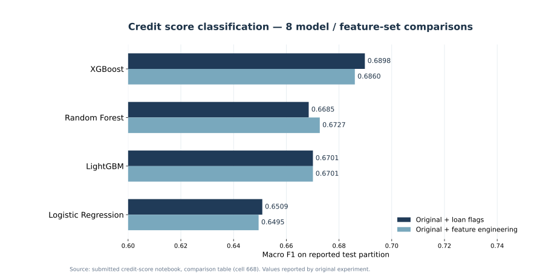
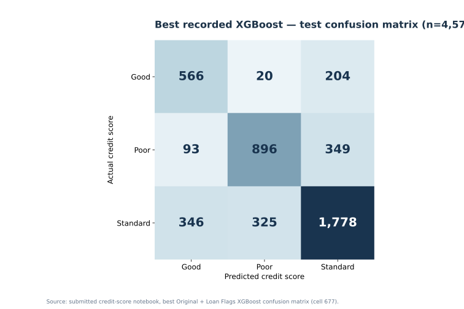

# Credit Score Prediction — Multiclass Machine Learning

**Python · Scikit-learn · XGBoost · LightGBM · Credit Risk Analytics**

An individual academic machine learning project that analyzes customer financial and credit behavior to predict three credit-score categories: **Good, Poor, and Standard**. The workflow includes detailed exploratory data analysis, correction of malformed financial fields, customer-aware training/test splits, feature engineering, model tuning, and multiclass evaluation.

> **Project boundary:** This repository documents the submitted classification experiment. An end-to-end MLflow / Streamlit / AWS deployment of this specific artifact is a separate project and is not claimed here.

## Results at a glance

| Item | Result |
| --- | --- |
| Initial dataset | **25,000 records**, 29 columns |
| Cleaned modeling dataset | **22,412 records** |
| Training / evaluation split | **17,835 / 4,577** observations |
| Customer leakage guard | **0 overlapping Customer_ID values** in train and test |
| Candidate configurations | **8** — 4 models × 2 feature sets |
| Top recorded model | **XGBoost**, Original + Loan Flags |
| Macro F1 (reported test set) | **0.6898** |
| Accuracy (reported test set) | **70.79%** |
| Multiclass ROC-AUC (OvR macro) | **0.8591** |



## Why this problem matters

Financial organizations may need to review differences in customer repayment and borrowing profiles. This educational study compares machine learning algorithms that organize those patterns into multiclass credit-score categories. **It is not a production lending policy or a validated consumer-credit decision engine.**

## Data understanding and privacy

The supplied source dataset (`data_C.csv`) contains repeated customer-month observations, features such as repayment delays, loan information, balances, interest rates, and customer identifiers including **Name and SSN**. It is **intentionally not published** in this repository.

The notebook was copied with **all cell outputs and embedded attachments removed** so it does not expose sample customer records in saved outputs. Specific Customer_ID values mentioned in selected EDA examples have also been replaced with stable anonymous placeholders. Customer-specific EDA and data-repair lookups that referenced those identifiers would need authorized IDs if rerun; the sanitized notebook is primarily for review and may not reproduce the original experiment verbatim. The remaining code and Markdown explanations remain available for methodological review. Only use a dataset you are licensed and authorized to process, preferably a suitably anonymized version.

## Methodology

1. **EDA and cleaning:** investigated duplicates, missing values, malformed string-numerics, outliers, credit-history inconsistencies, and repeated customer records.
2. **Group-disjoint split:** `StratifiedGroupKFold` with `Customer_ID` as the grouping key, so the same customer does not appear across the two reported partitions.
3. **Two feature strategies:**
   - **Original + Feature Engineering:** 32 features, including debt/investment/EMI/balance ratios, loan flags, and decomposed spending behavior.
   - **Original + Loan Flags:** 31 features: 17 numerical, 9 binary loan-type flags, and 5 categorical features. This produced the best recorded model.
4. **Pipelines:** scikit-learn `ColumnTransformer` and `Pipeline` for median/mode imputation, one-hot encoding, and linear-model scaling with `RobustScaler`.
5. **Tuning:** `RandomizedSearchCV`, with grouped folds, optimizing **macro F1**. The notebook uses a 5-fold × 20-candidate setup for the engineered feature set and 3-fold × 10-candidate setup for the original-plus-loan-flags feature set.
6. **Evaluation:** macro F1, accuracy, balanced accuracy, macro precision/recall, multiclass OvR ROC-AUC, and class-level confusion matrices.

## Experiment comparison

| Model | Macro F1 — Original + Loan Flags | Macro F1 — Original + Feature Engineering |
| --- | ---: | ---: |
| XGBoost | **0.6898** | 0.6860 |
| Random Forest | 0.6685 | 0.6727 |
| LightGBM | 0.6701 | 0.6701 |
| Logistic Regression | 0.6509 | 0.6495 |

See [full recorded metrics and confusion matrix](docs/RESULTS.md).



## Repository structure

```text
credit-score-prediction/
├── README.md
├── .gitignore
├── requirements.txt
├── notebooks/
│   └── credit_score_modeling_outputs_removed.ipynb
├── models/
│   └── final_best_credit_score_model.pkl
└── docs/
    ├── RESULTS.md
    ├── model-f1-comparison.svg
    └── xgboost-confusion-matrix.svg
```

## How to explore

Clone the repository and create a Python virtual environment. Install the dependencies in `requirements.txt`, then open the notebook via Jupyter or VS Code. The original notebook reads `data_C.csv` in the working directory; the dataset is **not included** here for privacy reasons. To rerun it, supply an authorized compatible dataset and review file paths and data permissions. The published notebook redacts specific customer IDs, so some customer-based EDA/cleaning examples may not reproduce the original results until those lookups are adapted using authorized data. This repository does **not** promise a one-command fully automated retraining pipeline.

The saved `.pkl` is provided as the **original artifact supplied by the author**. It was not deserialized or independently validated when this documentation was prepared. Only open pickle/joblib artifacts from trusted sources in an isolated environment, using compatible library versions. The model expects the feature preparation described in the notebook; it is not a turnkey raw-data API.

## Reproducibility and interpretation notes

- All numbers cited here were **transcribed from recorded notebook outputs**, not rerun or independently remeasured.
- The final notebook selects the overall best configuration **using the test set**. This means the reported final score is exploratory and should be independently confirmed using an untouched customer-grouped holdout or nested validation.
- Some cleaning takes place before the split; a stricter training-only fit/transform workflow is recommended for future experiments.
- No fairness, regulatory, calibration or external validation studies have been claimed. The project is best presented as a transparent academic modeling study.

## Portfolio

[View the website case study](https://hazel-portfolio-rose.vercel.app/projects/credit-score-prediction)

**Author:** Hazel Novero Winata · BINUS University
